# FORGE

**中世の鍛冶工程を、自作の物理シミュレーションで一から体験する一人称ゲーム。**
C++ / DirectX 11 の自作フレームワーク上で、加熱 → 鍛造 → 研ぎ → 焼入れ → 焼き戻し → 試し切り までを一本の流れとして遊べます。
内蔵 GPU（AMD Radeon 610M）で動作することを前提に作っています。

[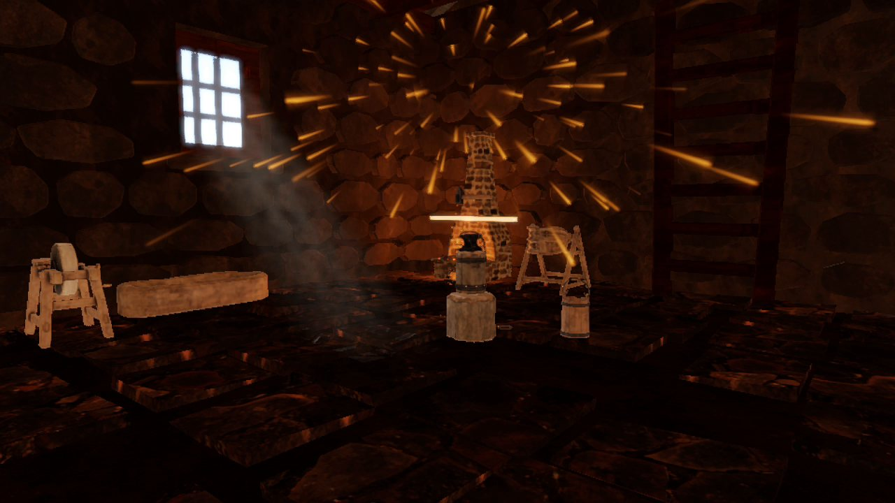](https://youtu.be/NNGcMfS_tb8)

▶ **[プレイ映像を見る（YouTube）](https://youtu.be/NNGcMfS_tb8)**

> 『Kingdom Come: Deliverance II』の鍛冶ミニゲームを出発点に、実際の鍛冶の工程を調べて工程を増やし、自分の解釈で作り直した作品です。

### 工程

| 加熱 | 鍛造 | 研ぎ | 焼入れ | 焼き戻し | 試し切り |
|:---:|:---:|:---:|:---:|:---:|:---:|
| 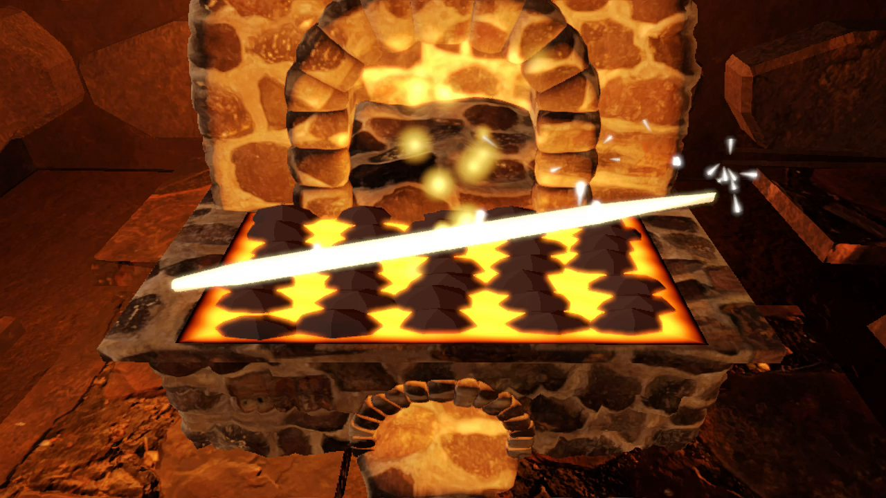 | 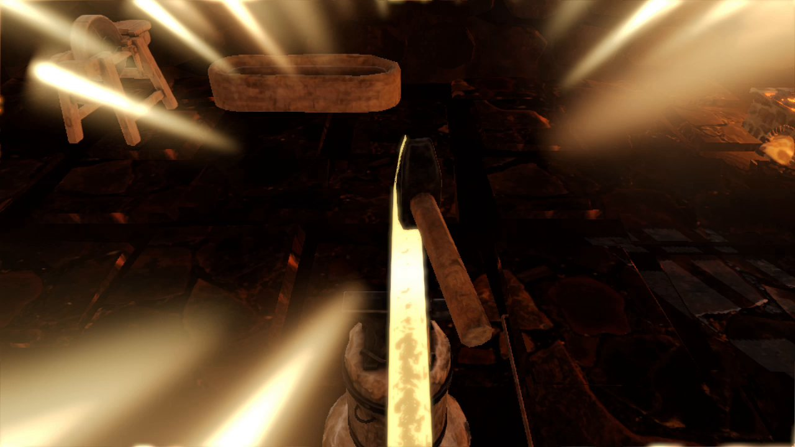 | 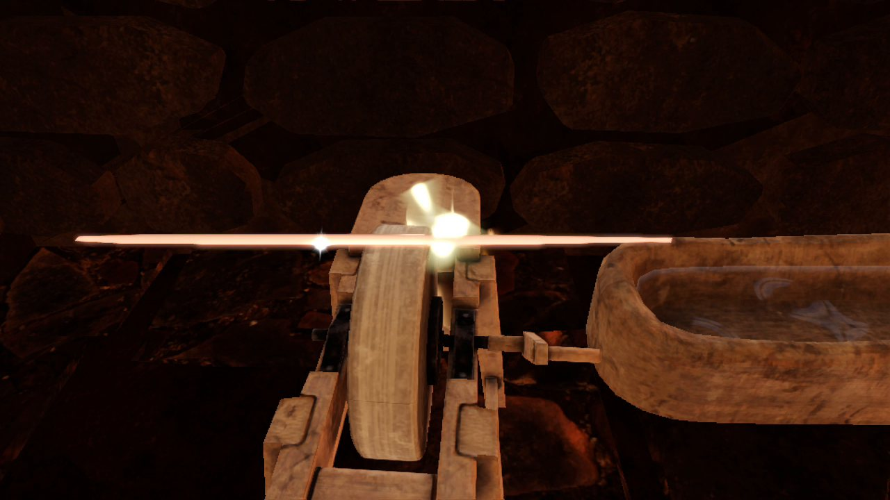 | 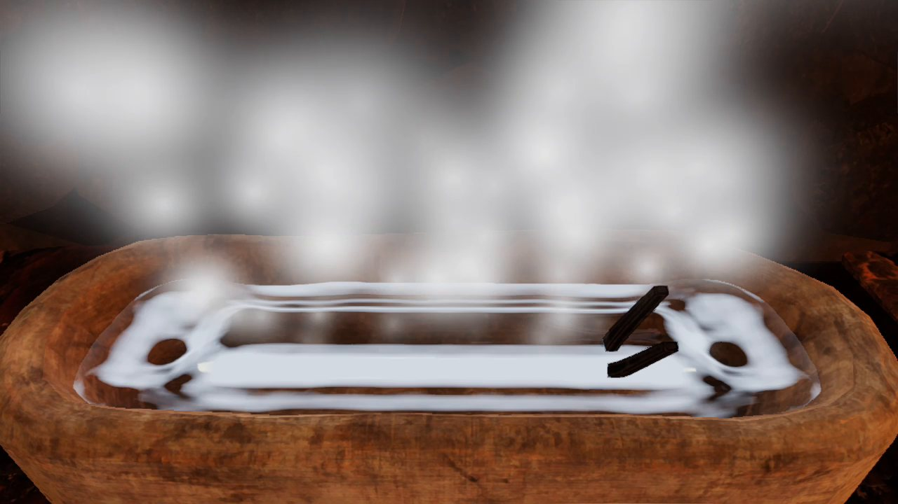 | 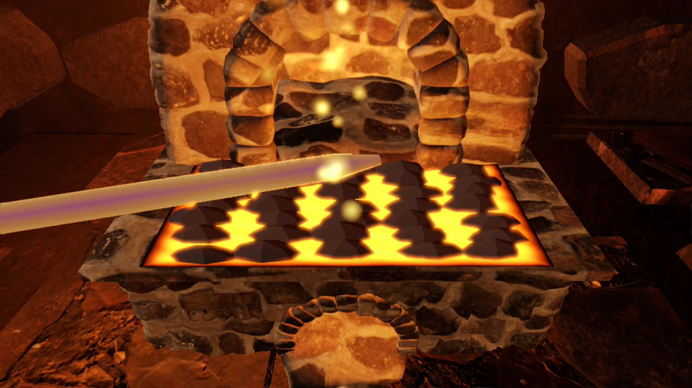 | 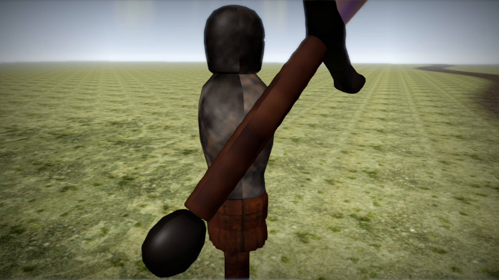 |

---

## 見どころ

| | 内容 | 主なコード |
|---|---|---|
| 鍛造シミュレーション | 金床の上の鉄を粗い高さ場（ハイトフィールド）で持ち、叩くと体積を保ったまま金属が流れる | `Physics/ForgingSim` |
| ハンマーの物理 | ばね-ダンパ（フックの法則＋減衰）をセミインプリシット・オイラー法で積分。振り上げのオーバーシュートも係数から自然に出る | `Physics/HammerPhysics` |
| 工程システム | 工程 = 状態。シーンの状態機の下に工程の状態機を置いた階層型ステートマシン（HSM） | `StateMachine/` |
| データ駆動のレシピ | 武器 = 「工程の順番＋各工程の案内文」のデータ。武器を増やす時はデータを足すだけ | `GameData/WeaponRecipe` |
| 試し切り | 平面によるメッシュ分割（断面は耳切り法で蓋をする）＋力積ベースの剛体で、斬った部品が落ちる | `Physics/MeshSlicer`, `Physics/RigidBody` |
| 焼入れの水面 | 2D 波動方程式の高さ場。刃を沈める・揺らすと波が広がり、壁で反射する | `Physics/WaterSim` |
| 足踏み砥石 | 一踏み = 角速度の力積、間は指数減衰。刃を当てると抵抗が増える | `Physics/GrindWheel` |
| ステージエディタ | 道具の配置をゲーム内で編集し、テキストファイルに保存。ゲーム本体も同じファイルを読む | `Scenes/StageEditor` |

**鍛造：叩くたびに刃の形ができていく**（左から 打ち始め → 途中 → 仕上げ間近）

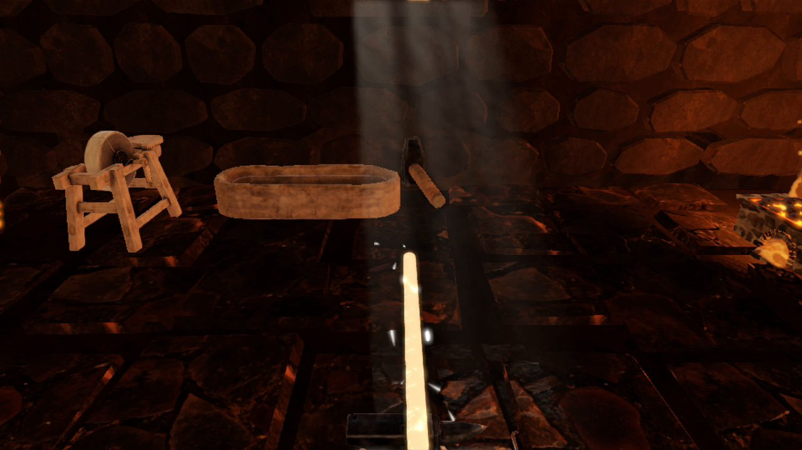 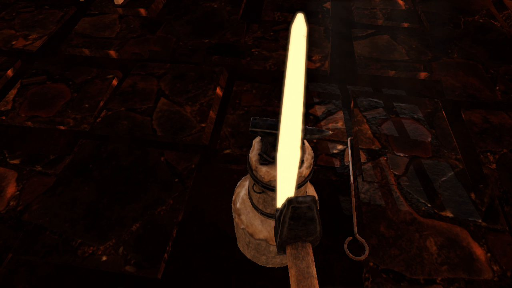 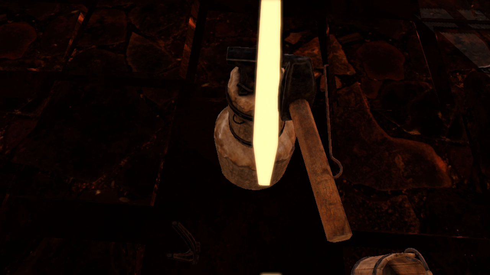

| 焼入れの水面（波動方程式） | 試し切り（メッシュ分割） |
|:---:|:---:|
| 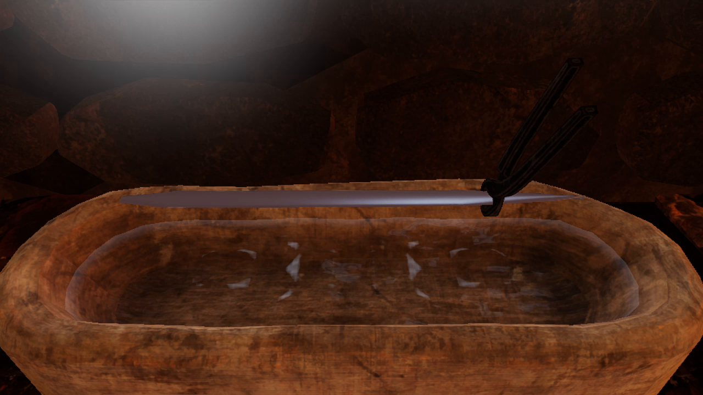 | 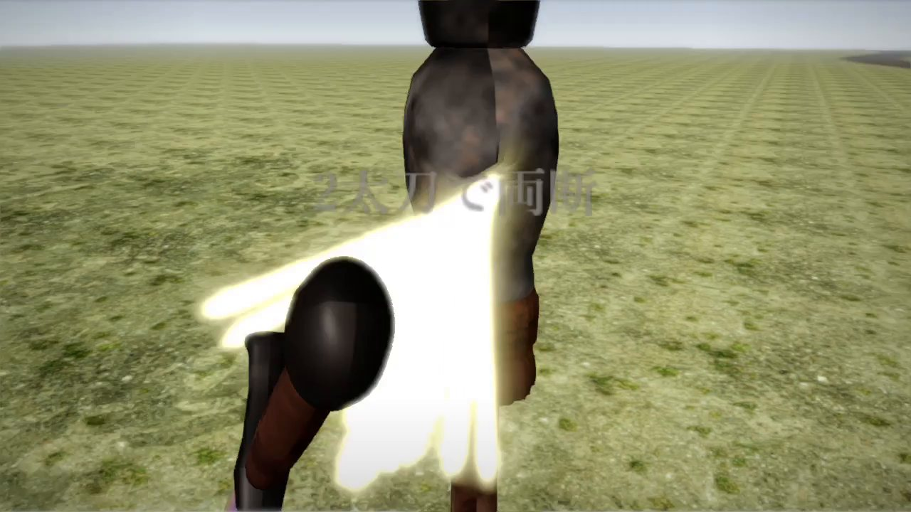 |

## 設計で考えたこと

作品の中で「何を選び、何を選ばなかったか」とその理由です。

- **工程はステートマシンで、コマンドパターンは使わない。**
  鍛冶の工程は「完了したら次へ」という遷移そのものなので、状態機が素直に合う。コマンドパターンの強みである undo / リプレイはこのゲームでは要らない。拡張性は「データ駆動のレシピ」で確保した。
- **階層型にする。** タイトル / プレイ / リザルトの状態機と、プレイ中の工程の状態機を分けた。工程を増やしてもシーン側のコードは変わらない。
- **失敗（武器の破損）システムは入れない。** 就職作品は企業の方に短い時間で触ってもらう物なので、一度のミスで最初からやり直しになる設計は合わない。ミスは検知して、セリフや音で知らせる（罰ではなく情報として伝える）。
- **作業量は「残り」で管理する。** 有効な一打で減る量を固定し、打ち方の良し悪しはスコアにだけ反映した。進捗が 99% で止まる事が無く、何回叩けば終わるかが設計できる（`Physics/WorkField`）。
- **手触りを優先し、リアルさはその次。** 実際の工程を土台にしつつ、遊んで気持ち良いかどうかを最終的な判断基準にした。
- **アニメーション・エフェクト・物の位置を切り離す。** エフェクトはアニメのフレームではなく温度や工程の状態で発生させる。物の位置はアンカー（金床の上面など）からの相対配置で、モデルを差し替えても再調整が要らない。
- **内蔵 GPU で動かす。** ボリューメトリックな炎のレイマーチングなど重い手法は避け、事前計算と軽いスクリーン空間の処理で見た目を作った。

## 描画（物理とゲームの読みやすさを支える部分）

物理ベースレンダリング（PBR）とイメージベースドライティング（IBL：リフレクションプローブ＋BRDF LUT）、太陽のシャドウマップ、ボリューメトリックライト、自動露出、ブルーム、輪郭線（背面法）。
シェーダーはすべて `.hlsl → fxc（ビルド時）→ .cso` の流れでコンパイルしています。

<!-- TODO: F3 の GPU プロファイラで測ったフレーム時間（Radeon 610M, 解像度）をここに書く -->

## フォルダ構成

```
SampleProjectBase/
  Engine/        フレームワーク: DirectX 初期化, 入力, シェーダー/テクスチャ/モデル読み込み, 音, カメラ, シーンツリー
  Rendering/     描画パス: PBR, IBL, ポストプロセス, ボリューメトリックライト, 自動露出, 輪郭線, GPU プロファイラ
  Shaders/       HLSL シェーダー（ビルド時に Assets/Shader/*.cso へコンパイル）
  Scenes/        シーンの根 (SceneRoot), ステージエディタ, パーティクル調整シーン
  SceneForge/    ゲーム本体のシーン（工程の進行, HUD, カメラ/照準, 運搬, 衝突, 試し切りの的）
  StateMachine/  汎用の状態機と、各工程の状態（加熱/鍛造/研ぎ/焼入れ/焼き戻し/試し切り）
  GameLogic/     エンジンに依存しないゲームシステム（照準, プレイヤ, 入力, ゲームパッド, 昼夜）
  GameData/      データ: 武器のレシピ, 材質, 可動部品, ステージの定義
  Physics/       自作の物理: 鍛造, ハンマー, 剛体, メッシュ分割, 水面, 砥石, 2D 衝突, パーティクル
  Tools/         アセット変換や検証のスクリプト, 配布用パッケージ作成 (PackRelease.ps1)
  Assets/        モデル, テクスチャ, 音, 配置データ
  ThirdParty/, assimp/, DirectXTex/, imgui/   外部ライブラリ
```

## ビルド

- Windows 10/11, x64
- Visual Studio 2022 以降（プラットフォームツールセット v143, C++17）
- `SampleProjectBase.sln` を開き、`Debug|x64` または `Release|x64` でビルドして実行
- 外部ライブラリ（assimp, DirectXTex, Dear ImGui, SDL3）はリポジトリに同梱

配布用のフォルダは `Tools/PackRelease.ps1` で作成します。

## 使用ライブラリ

- [Dear ImGui](https://github.com/ocornut/imgui) — デバッグ UI（MIT）
- [Assimp](https://github.com/assimp/assimp) — FBX / OBJ の読み込み（BSD-3-Clause）
- [DirectXTex](https://github.com/microsoft/DirectXTex) — テクスチャ読み込み（MIT）
- [SDL3](https://www.libsdl.org/) — ゲームパッド入力と振動（zlib）

## 素材とクレジット

効果音・BGM・モデル・テクスチャ・フォントの出典とライセンスは [CREDITS.txt](CREDITS.txt) にまとめています。
音声・購入素材など、ライセンス上ファイルの再配布ができない素材はリポジトリに含めていません。そのため、このリポジトリをクローンしただけではゲームを実行できません。動作はプレイ映像でご確認ください。

## 作者

HAL 在学中の個人制作（就職作品）。ベースは授業の DirectX 11 教材です。
